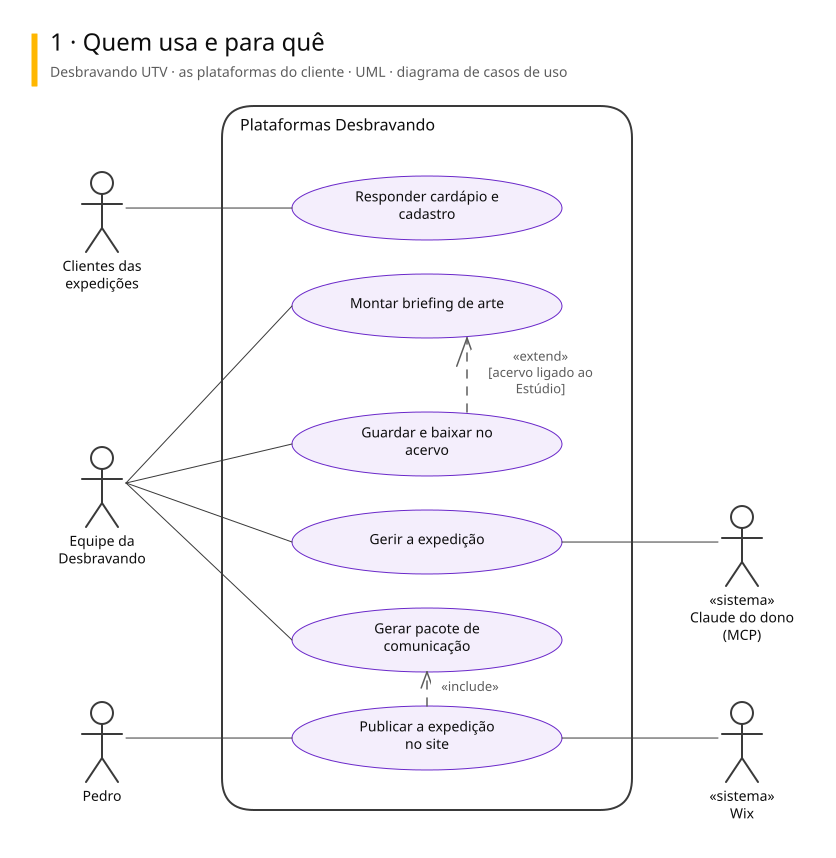
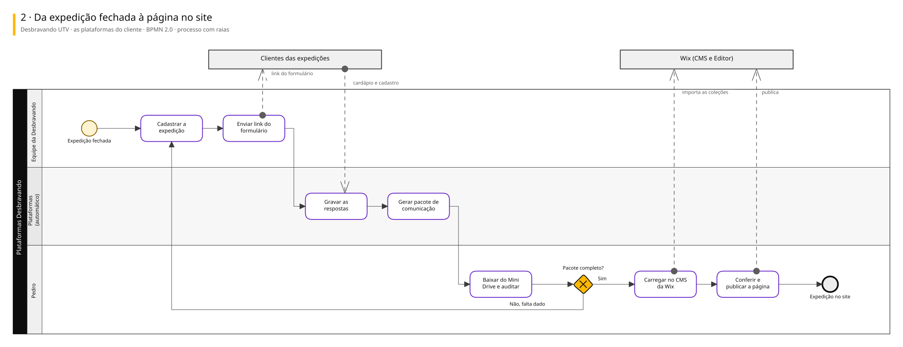
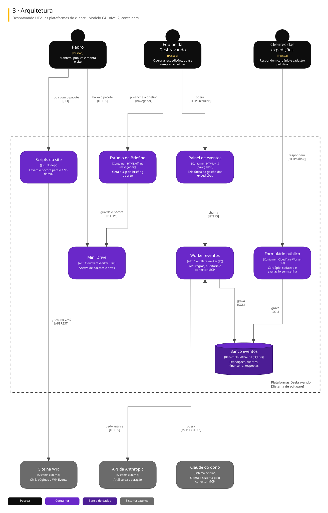

# Arquitetura

Diagramas de 2 sistemas ligados a este repositório. Cada um tem três vistas, cada vista numa notação padrão.

| Vista | Notação | Responde |
|---|---|---|
| 1. Casos de uso | UML | Quem usa e para quê |
| 2. Processo | BPMN 2.0 | Como o trabalho anda, com uma raia para cada quem executa |
| 3. Arquitetura | C4, nível 2 | De que partes o sistema é feito e com quem conversa |

## Desbravando UTV · as plataformas do cliente

Guarda-chuva das ferramentas que o Pedro mantém para a Desbravando UTV, operação de expedições de UTV: controle das expedições, formulário público, acervo de arquivos, estúdio de briefing e o site na Wix.

### 1. Quem usa e para quê

### 2. Da expedição fechada à página no site

### 3. Arquitetura

Para editar: [desbravando-utv.excalidraw](./desbravando-utv.excalidraw), que abre em [excalidraw.com](https://excalidraw.com) ou na extensão Excalidraw do VS Code.

## Site Desbravando · repaginação dentro da Wix

Repaginação do site desbravandoutv.com sem sair da Wix: o design nasce em código e vira manual de montagem, o conteúdo das expedições entra no CMS por script e o pagamento segue no Wix Events. A troca de plataforma ficou adiada.

### 1. Quem usa e para quê

### 2. Do pacote da expedição à página no ar

### 3. Arquitetura

Para editar: [site-desbravando.excalidraw](./site-desbravando.excalidraw), que abre em [excalidraw.com](https://excalidraw.com) ou na extensão Excalidraw do VS Code.

## De onde vêm

Os diagramas são gerados a partir do Sinapse, o vault onde o Pedro organiza notas e projetos. Mudança feita direto aqui some na próxima publicação: o lugar de mudar é a especificação no Sinapse.
